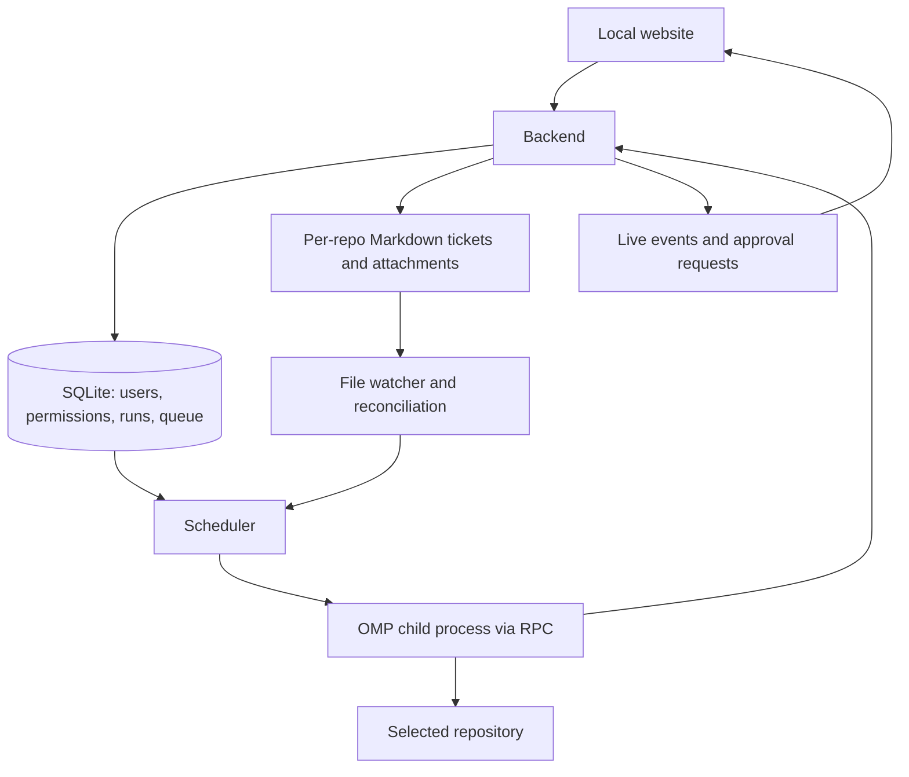
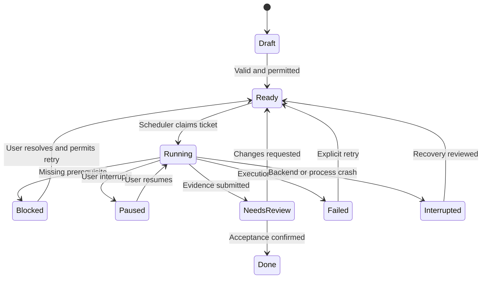

# OMP Backlog Web — approved implementation plan

## Scope and defaults

Build a single-user, local-only website with login, separate repository workspaces, Markdown tickets with attachments, a persistent scheduler controlling OMP through RPC, explicit execution permission, pause controls, and verification evidence.

Approved defaults:

- Single owner account; no public registration or roles.
- Loopback-only access.
- TypeScript + Bun backend, React + Vite frontend, SQLite database.
- Markdown ticket directories inside each repository.
- Repositories initially paused.
- One active ticket globally, with fair rotation between repositories.
- Fresh OMP session per ticket.
- Human completion review by default.
- No automatic commits, pushes, deployments, or destructive cleanup.

One backend process and one database are sufficient. Scheduling is a module inside the backend, not a separate service. No Redis, Docker, or multi-agent orchestration is needed.

The initial project setup is runnable development tooling and a project overview only. Login, repository management, tickets, scheduling, and execution controls must not be presented as operational before implementation and verification.

## 1. Architecture



| Area | Choice | Reason |
| --- | --- | --- |
| Backend | TypeScript + Bun | OMP integration, child processes, SQLite support |
| Frontend | React + Vite | Interactive dashboard with familiar development tooling |
| Database | SQLite | Durable local state without a database server |
| Live updates | Server-Sent Events | Stream progress; use normal requests for actions |
| Agent transport | OMP rpc-ui | Progress plus agent questions and supported approval dialogs |
| Tickets | Markdown files per repository | Editable through website or editor; portable |

Keep process lifecycle independent of the browser. Closing a tab must not terminate work. The application's scheduler selects tickets; OMP executes each ticket's goal.

## 2. Login and local security

- Create the initial owner through terminal setup, not an unauthenticated website setup screen.
- Hash passwords with Argon2id; never store plaintext passwords.
- Use server-side sessions with HttpOnly, SameSite cookies, appropriate expiry, and session invalidation on logout.
- Implement login throttling, CSRF protection, and strict Host/Origin validation.
- Bind to 127.0.0.1; no LAN exposure by default.
- Restrict permissions on database, session records, and upload storage.
- Do not expose OMP credentials through the website, logs, or database exports.
- Logout does not silently cancel running work; expose execution controls separately.

Local login protects dashboard access. It does not sandbox commands. OMP operates with the backend user's filesystem permissions. Repository separation is organizational unless stronger OS isolation is implemented. Do not describe a selected working directory as a security sandbox.

## 3. Repository selection and separation

A browser folder-upload control does not reliably provide the normal server filesystem path needed for execution. Build an authenticated backend-powered folder picker.

Initial permitted root: ~/Development.

Registration flow:

1. User selects Add repository.
2. Browse directories within permitted roots.
3. Select a folder.
4. Resolve its canonical path, check access, and detect its Git root.
5. Show the actual execution directory and register a stable repository ID.

Rules:

- Reject duplicate canonical roots, including aliases through symlinks.
- Prevent browsing outside permitted roots, including through symlink traversal.
- Prefer existing Git repositories; permit non-Git workspaces with a clear warning that Git change tracking is unavailable.
- Never initialize Git, switch branches, reset files, or clean working trees automatically.
- Give each repository separate tickets, permissions, runs, and transcript history.
- Never overwrite unrelated working-tree changes. Surface conflicts or unsafe overlapping work before execution.

## 4. Backlog and ticket storage

Use one Markdown file per ticket instead of a growing single BACKLOG.md. This simplifies attachments, external edits, revisions, and conflicts.

```text
my-repo/
  .omp-backlog/
    tickets/
      T001/
        ticket.md
        attachments/
          login-reference.png
          example-response.json
      T002/
        ticket.md
```

Keep the application database, run snapshots, and transcript records in a private application data directory outside registered repositories.

### Ownership

- Markdown owns title, goal, requirements, acceptance criteria, dependencies, scope, verification instructions, and attachment references.
- SQLite owns approval, runtime status, ordering, attempts, pause state, and evidence records.
- The website combines these views; do not maintain competing status fields in both stores.
- Automatic conversion or splitting of existing BACKLOG.md files into tickets is out of scope and is not pending work. Users may explicitly load Markdown into a single-ticket draft and adapt it manually. Never silently rewrite or discard existing BACKLOG.md files.
- The RPC worker selects one ticket. Do not ask the installed backlog-worker skill to independently process the entire backlog in parallel with the scheduler.

### Recommended ticket format

```markdown
---
id: T001
title: Add order CSV export
depends_on: []
---

# Goal
Authorized users can export the currently filtered orders as CSV.

# Context
Orders page already supports date and status filters.

# Requirements
- Add an Export CSV action.
- Apply the same filters used by the visible orders list.
- Preserve existing authorization checks.

# Acceptance criteria
- Export contains only orders matching selected filters.
- Commas, quotes, and newlines are escaped correctly.
- Unauthorized requests are rejected.
- Existing order-list behavior remains unchanged.

# Out of scope
- Scheduled exports.
- Email delivery.
- Changing order permissions.

# Verification
- Exercise filtered export in the browser.
- Check CSV escaping using representative records.
- Run relevant existing tests.

# Attachments
- [UI reference](attachments/export-reference.png)
- [Example records](attachments/example-records.json)
```

Good tickets specify an outcome, scope, observable acceptance, and verification. Clarify materially ambiguous requirements before approving execution. Do not invent requirements.

Each uploaded attachment must have at least one inline Markdown link or image with a nonblank purpose label or quoted link title. Incomplete drafts and upload staging may be saved, but unreferenced attachments or missing purpose labels block approval and execution, including Automatic mode. Empty duplicate references are allowed if another reference to the same file supplies its purpose. Humans assess whether the purpose is meaningful. Screenshot requirements should identify viewport, relevant elements, and acceptable differences. JSON examples should use synthetic data, not credentials or customer records.

### Attachment handling

- Support images, JSON, text, and documents, with enforced size limits.
- Render Markdown safely; do not execute raw HTML.
- Serve attachments only through authenticated routes.
- Prevent path traversal and symlink escapes.
- Never execute uploaded files.
- Treat attachment contents as requirements or references, not authority to override security policy.
- Deliver supported images through RPC image input; provide other files through explicit file references.
- Snapshot referenced attachment contents with the ticket revision used for a run.

## 5. Scheduler and change detection

The watcher notices changes. The scheduler determines eligibility and execution permission. A file change is not permission by itself.

### Repository execution modes

| Mode | Behavior |
| --- | --- |
| Paused | Reconcile and display changes; start nothing |
| Approved tickets only | Run explicitly approved ticket revisions |
| Automatic | Standing permission to run new valid tickets and eligible revisions |

New repositories start paused. Recommend Approved tickets only until the user deliberately enables Automatic. Show the implications of automatic execution before granting standing permission.

### Scheduling algorithm

1. Reconcile ticket files and attachments.
2. Wait for stable writes; validate ticket structure and dependency references.
3. Check repository mode and ticket permission.
4. Choose an eligible ticket whose dependencies are Done.
5. Atomically claim the ticket in SQLite.
6. Start a fresh OMP session in the selected repository.
7. Persist progress, questions, verification evidence, and outcome.
8. Release the claim and select the next eligible ticket.

Invariants:

- One active ticket globally initially.
- Fair rotation across repositories; no single backlog monopolizes execution.
- Use filesystem watching plus periodic reconciliation because events may be missed.
- Repeated events must not create duplicate runs.
- Invalid tickets, missing dependencies, and dependency cycles produce actionable errors and do not execute.
- Persist execution permission, queue state, and run identity across application restarts.
- Enforce time/token execution limits and operator interrupts; never restart automatically to evade limits.

### Edits and revision approval

Each run uses an immutable snapshot of Markdown and referenced attachments.

- External edits affect a new revision, not an active run's instructions silently.
- Show Requirements changed during execution.
- An old run cannot mark a new revision complete.
- In approved-only mode, requirement or attachment changes invalidate prior approval.
- Editing a completed ticket creates a revision to assess, not an immediate blind rerun.
- Concurrent edits must not be overwritten silently; detect stale saves and ask the user to reconcile.

## 6. Pause, blockers, completion, and recovery

### Controls

- Pause repository: prevent new starts; current run continues.
- Pause current run: pause goal continuation and interrupt active execution.
- Resume: explicit permission to continue.
- Pause all: prevent new starts globally; make treatment of the current run explicit.

Pausing does not roll back completed actions. Show Stopping until the agent and relevant child work have actually stopped. Do not promise transactional cancellation of external side effects.

### Ticket lifecycle



### Completion gate

Needs review precedes Done by default. An agent's success claim, a successful command admission, or process exit is not sufficient proof.

- Require criterion-by-criterion evidence tied to the run's revision.
- Keep human review for visual or subjective criteria.
- Automatic completion is appropriate only for explicit, approved machine-checkable criteria; it must not weaken the criteria or trust arbitrary uploaded code as executable validation.
- Dependencies wait for Done, not merely an agent yield or Needs review.
- Do not claim unperformed verification passed.

### Blockers

- Investigate actionable failures before declaring a blocker.
- Record the exact unavailable prerequisite and required unblock action.
- Preserve partial work and evidence.
- Continue independent tickets when safe; never start dependent or conflicting work.
- If none remain actionable, wait rather than repeatedly retry an unchanged failure.
- Reassess prerequisites after the user's unblock update before retrying.
- Do not manufacture credentials, weaken acceptance, or bypass approvals to unblock work.

### Recovery

- Persist OMP session ID, run identity, selected repository, and revision.
- On startup, reconcile previously active runs and any surviving child process before launching another ticket.
- Mark unresolved runs Interrupted; do not blindly replay mutating actions.
- Require recovery review before retrying interrupted work.
- Closing the browser does not stop a run. Backend shutdown must explicitly coordinate child shutdown and persist the observed outcome.

## 7. OMP integration

Launch OMP with --mode rpc-ui so supported agent questions and approval dialogs can reach the browser. Do not use --no-ui for this approval-capable flow.

The backend must:

- Wait for the ready frame and correlate command IDs and responses.
- Negotiate supported protocol framing or reuse a compatible official client; enforce transport limits.
- Continuously drain stdout and stderr.
- Persist OMP session identity.
- Deliver progress through SSE and user actions through authenticated requests.
- Render agent questions and supported approval requests in the website.
- Fail closed when approval cannot be obtained; do not silently approve a disconnected browser's request.
- Distinguish prompt admission, agent yield, session settlement, and verified ticket completion.
- Record provider errors as execution failures even if the original prompt command was admitted successfully.
- Keep process lifecycle separate from ticket outcome.

Configure goal.continuationModes to include rpc through an application-owned launch overlay, not by modifying global OMP settings. This covers rpc and rpc-ui.

Only one mechanism owns each level of continuation:

- OMP goal mode continues work inside a ticket.
- Scheduler advances between tickets.
- Do not layer /loop over both.

Relevant primary documentation:

- OMP RPC protocol: omp://rpc.md
- Startup and framing: omp://rpc.md (Startup; Transport and Framing)
- Prompt completion and settlement: omp://rpc.md (Prompt payload; Yield vs settled)
- Goal operations and goal.continuationModes: omp://rpc.md (goal command documentation)
- Questions and approvals: omp://rpc.md (Extension UI Sub-Protocol)
- Public source repository: https://github.com/can1357/oh-my-pi

## 8. Website pages

| Page | Functions |
| --- | --- |
| Login | Owner authentication |
| Repositories | Folder registration, queue summary, execution mode |
| Repository backlog | Ordering, dependencies, status, permission, pause |
| Ticket editor | Markdown editor and preview, attachments, acceptance criteria |
| Run detail | Live transcript, questions, evidence, changed-file summary, controls |
| Settings | OMP executable/model, limits, permitted folder roots |

Keep blocker questions and approval requests prominent, not buried in logs. Support keyboard access, visible focus, readable contrast, responsive layouts, and reduced-motion preferences. Never use fake repositories, fabricated runs, or nonfunctional controls to imply implemented behavior.

## 9. Implementation sequence and acceptance

| Phase | Deliverable | Acceptance |
| --- | --- | --- |
| 1. Application and login | Local server, SQLite, owner setup, sessions | Unauthenticated protected access denied; logout invalidates session |
| 2. Repositories | Folder picker and separate workspace records | Symlink duplicates rejected; repositories remain separate |
| 3. Tickets | Markdown editor, attachments, external-change detection | External edits appear; unsafe paths and rendering rejected |
| 4. OMP execution | Single-ticket RPC execution and live website | Real ticket runs; questions and approvals reach browser; outcome persisted |
| 5. Scheduler | Watching, permissions, dependencies, pause/resume | New eligible ticket runs once; paused repository never starts work |
| 6. Recovery and verification | Snapshots, evidence review, restart handling | Crash becomes Interrupted; no blind replay; new revision cannot inherit old success |

Verify with disposable repositories and real OMP execution. Browser verification must cover login, upload, permission, pause, blockers, and completion review. Exercise watcher duplicate events, dependency cycles, active-ticket edits, browser disconnects, backend restart, and failed provider turns. Use deterministic automated tests for state transitions, permissions, path containment, approval/revision binding, and duplicate-run prevention.

### Implementation and verification status

All six implementation phases have code paths. Repository cards now show lifecycle-status counts, and attachment-purpose validation participates in ticket eligibility. Automatic BACKLOG.md conversion remains out of scope.

Verification completed using isolated application data and disposable workspaces:

- Real browser/OMP flow: owner login, folder registration, authenticated upload, exact-revision approval, paused repositories starting nothing, agent questions and supported tool approvals, proof-file write/read, persisted criterion evidence, human completion review, and dependent execution only after Done in a fresh session.
- Real interruption flow: closing the browser left an unanswered question pending without granting consent; pause cleared the dialog and stopped the child; resume retained the session and required a new answer. A Stop answer produced an investigated blocker and explicit retry used a fresh session.
- Real revision/restart flow: edits during execution invalidated approval without changing the run snapshot; restarting the backend left the unfinished run Interrupted without replay, preserved completed tickets, and rejected completion of changed requirements using old evidence.
- Browser surface: per-repository counts matched persisted statuses on desktop and mobile, with no horizontal overflow at a 390px viewport. Logout revoked protected access.
- Deterministic suite: 40 tests passed, covering permissions, paths, dependency cycles, revision/attachment approval binding, actual duplicate filesystem events, multi-repository fairness, global-slot exclusion, post-admission provider errors, pause/resume identity, active-edit completion binding, surviving-child recovery, and time/token limits. Provider-error and limit cases use a protocol-speaking child fixture, not an induced live-provider outage.
- ESLint and strict TypeScript checks passed. No production build was run.

These checks establish the exercised scenarios, not sandboxing or universal provider compatibility. Semantic attachment-purpose quality and visual/subjective ticket acceptance remain human review responsibilities.

## 10. Planned execution-loop improvements

Status: partially implemented; delivery boundaries below. Research and primary sources: [Agent completion and autonomous ticket loops](docs/agent-completion-loop-research.md) and [Cursor pstack verification workflow](docs/cursor-verification-skill-research.md). Section 11 expands the verification and workflow adoption scope.

Keep the existing ownership model: scheduler selects tickets; native OMP goal mode continues work within one ticket. No additional `/loop`, mandatory completion skill, or multi-agent orchestration. Preserve human acceptance before Done, revision-bound requirements, time/token limits, and explicit retry permission.

Implement in this priority order:

### 1. Trustworthy verification evidence

- Link each acceptance criterion to observed verification: command/check, exit status or outcome, relevant output, and artifact paths. Distinguish host-recorded observations from agent-written claims.
- Capture results from supported verification paths; do not label unsupported or unobserved checks as independently verified.
- Run only explicitly permitted checks under repository policy. Never execute arbitrary ticket attachments or uploaded validation code as trusted checks.
- Keep visual/subjective acceptance and final Done decisions under human review. A passing command alone does not prove every criterion.
- Acceptance: reviewer can trace each completion claim to its evidence source and run revision; failed, missing, or unperformed required checks cannot be presented as passing.

### 2. Safe working-tree handoff

- Address the current constraint: agents cannot commit, while pre-existing Git changes block new ticket execution. Acceptance alone does not clean the working tree.
- Selected policy: operator review and reconciliation outside the app. Git changes or unavailable inspection persist a project-level handoff gate; staged/unstaged/untracked files reported by Git outside `.omp-backlog/` block new starts. No per-ticket isolation or automatic commit authority.
- Operator preserves/reconciles work under their own authorization, then explicitly chooses Recheck workspace. Authenticated/CSRF-protected recheck inspects Git with optional locks disabled and clears only the reviewed gate if clean and no run owns that workspace. A stale gate, dirty state, inspection failure, or active/paused work cannot be bypassed. Merely becoming clean or marking Done does not release a recorded gate. Existing permissions/dependencies/global pause still apply; previously blocked tickets still require explicit retry.
- Preserve unrelated changes and partial work. Never reset, discard, or automatically commit changes to advance the queue.
- Acceptance: prior-ticket changes produce an actionable handoff state; subsequent work starts only under the selected safe policy, with existing changes preserved.

### 3. Correct blocked-goal lifecycle

- An unresolved prerequisite produces a blocked result with partial evidence, exact prerequisite, and required unblock action—not a claim that the objective was achieved.
- Host pauses goal continuation and coordinates settlement/shutdown. Do not instruct the agent to complete an unmet goal; the model goal tool has no pause operation.
- Preserve evidence and partial changes; release execution ownership only after child work is observed stopped. Unchanged blockers require explicit retry, not an automatic loop.
- Acceptance: a blocked submission reaches Blocked without falsely completing the goal or leaving child work running; dependent tickets remain ineligible.

### 4. Clearer live progress

- Show current phase, criterion-level verification results, latest action, and available time/token usage alongside the live transcript.
- Distinguish agent-reported phases from host-observed execution and verification. Unknown or unverified states stay explicit.
- Show observed usage with its accounting basis; host session totals and OMP goal totals differ. Do not invent percentage completion from tool activity or elapsed time.
- Acceptance: running, waiting for an answer, blocked, stopping, and Needs review states remain distinguishable; progress updates survive reconnect without implying unsupported success.

### Verification before delivery

Add focused deterministic coverage for evidence provenance, failed/missing checks, blocked shutdown, safe handoff, and progress-state accuracy. Exercise affected browser and disposable-repository OMP flows before claiming end-to-end verification. Record checks actually performed separately from these planned acceptance conditions.

## 11. Planned pstack workflow adoption

Status: partially implemented; delivery boundaries below. Adopt the useful workflow discipline from [Cursor's official pstack plugin](https://github.com/cursor/plugins/tree/main/pstack), adapted to OMP and this application's existing safety gates. [Full inventory and current-state comparison](docs/pstack-comparison-research.md) inspect pstack 0.15.32 at commit `e73df471cd4bd918367e99f3dd9c51bd53ddf5f0`: 58 registered skills, 23 playbooks, two agents, helpers and optional Benny automation. Primary metadata credits Lauren Tan. Upstream supplies no OMP adapter or bundled enforcement hooks; inventory completion does not authorize wholesale installation or execution.

### Scope and compatibility

- Separate two deliverables: project-local workflows for developing this application, and application support for equivalent workflows in each registered target repository. Proving this app's skill does not prove another project's skill.
- Compare every upstream component with current behavior before adoption. Record its purpose, dependencies, portability, gaps, policy conflicts, and proposed acceptance checks. Distinguish prompt instructions from executable enforcement and implemented features from recommendations.
- Keep one active ticket globally, revision-bound approval, native OMP goal continuation, time/token limits, explicit blocker/recovery handling, and human acceptance before Done.
- Do not replace the scheduler, add a competing backlog loop, or automatically import Cursor-specific agents/hooks/configuration. Any future multi-agent work must preserve execution ownership and verification-instance isolation; parallel ticket execution remains out of scope unless separately approved.
- Commits, pushes, PR creation, deployments, branch changes, and destructive cleanup remain unauthorized by ordinary ticket execution. Upstream workflow instructions cannot override these restrictions. Choose any shipping or isolation policy explicitly before implementation.

### A. Commission a verification skill per project

- Adapt the generator's repository interview: identify user surfaces, documented startup/setup, existing driving harnesses, observable side effects, and safe instance isolation. Prefer existing tooling; do not introduce dependencies without approval.
- Write the generated skill to an OMP-discoverable project location, such as `.omp/skills/verify-<app>/SKILL.md`, with valid name/description metadata. Copying `.cursor/skills/` alone does not integrate with current skill suggestions.
- Include exact Launch, Doctor, Drive, Evidence, Cleanup, and Helpers instructions. Startup must reach a usable state, including safe owner/seed setup, not merely an answering port. Doctor is read-only; driving uses real user paths and stable selectors/commands.
- Seed `features/README.md` and an initial 3–5 feature files. Record sub-features, all supported user entry points, concrete driving instructions, observable outcomes, and gotchas. Initial inventory is not exhaustive coverage.
- Commission by running launch → doctor → one mapped journey → capture proof → cleanup, then confirm proof survives. Clean up owned resources after failed attempts too. Unexecuted recipes remain Draft; unavailable prerequisites remain explicit failures/blockers.
- Acceptance: another agent can follow the documented recipe without hidden setup, demonstrate one real journey, and retain evidence after teardown. Keep protocol-fixture results distinct from real OMP/provider/browser proof.

### B. Integrate verification into the existing ticket flow

- Identify and read the applicable project verification skill and relevant feature-map entries before completing an affected ticket. Missing required recipes, access, or setup must be reported; never substitute invented checks.
- Flow: approved immutable ticket → inspect relevant skill/map → implement → drive affected journeys → observe outcomes and side effects → fix/recheck within budget → submit criterion evidence → settle safely → Needs review → human Done.
- Exercise relevant mapped entry points independently; one convenient route does not prove alternate UI/CLI paths. Match verification scope to the completion claim, without requiring a whole-project maintenance pass on every small ticket.
- Preserve repository verification policy. Skill instructions do not grant permission to run forbidden commands, use live credentials/data, or bypass approval. Stop on unavailable prerequisites, exhaustion, or no progress rather than weakening expected results.
- Acceptance: completion review identifies affected journeys, checks actually performed, observed failures, and remaining unverified boundaries; no skipped required journey is presented as passing.

### C. Store run-owned proof and provenance

- Store screenshots, command/check results, logs, and other proof as private run-owned artifacts, separate from immutable requirement attachments. Writing proof must not change ticket requirements or invalidate their approval.
- Associate evidence with run ID, ticket revision, criterion, feature/entry point, action, observed result, artifact reference, and evidence source. Record the verification recipe version or content identity used; distinguish agent assertions from host-observed records.
- Add authenticated, path-constrained access to supported proof artifacts and show them beside criterion evidence in the run panel. Apply appropriate file/type/size limits and safe rendering; do not expose arbitrary filesystem paths or credentials through artifacts.
- Keep artifacts outside disposable verification state so cleanup cannot erase proof. Define retention and operator-authorized deletion separately; avoid automatic destructive cleanup of existing data.
- Acceptance: reviewer can inspect action → outcome → relevant side effects and trace proof to the correct run. Proof survives teardown/reconnect; unauthorized access and path escapes are rejected.

### D. Maintain maps and preserve review feedback

- Add an explicitly invoked maintenance workflow that reconciles feature maps with source and live behavior. Commissioning proves one journey; a full maintenance pass covers every mapped feature and its required entry points.
- Classify failures as documentation drift, harness gaps, or product gaps. Re-drive harness fixes; never rewrite expected behavior to conceal a product failure. Missing prerequisites remain unverified, not passing.
- Drive shared live instances serially; isolate any separately driven instances. Bound attempts, time, and tokens, and preserve partial proof when blocked.
- Persist actionable human feedback when requesting changes, linked to the reviewed run/revision, and deliver it to the next authorized attempt. A status reset alone is not a corrective handoff. Revalidate changed requirements and safe working-tree ownership before another run.
- Acceptance: maintenance identifies stale/missing journeys without silently editing product behavior; a subsequent attempt receives the specific review findings and records fresh evidence rather than recycling old claims.

### Adoption order and delivery gate

1. Use the completed pinned upstream inventory and current-state comparison as the baseline; select components and resolve scope/policy conflicts before porting them.
2. Commission and prove this application's local verification skill and initial feature map in an isolated environment.
3. Implement run-owned evidence/provenance and review-feedback handoff, then integrate affected-journey verification into ticket execution and review.
4. Add explicit map maintenance and opt-in onboarding for other registered repositories. Broader pstack components remain individually research- and approval-gated.

### Broader component candidates, not blanket parity

- Next candidates: small OMP-compatible investigation, bug-fix, feature/refactoring and verification recipes; optional risk-scaled independent review; concise decision trails and catch-up. Reviewers require actual permission/tool isolation, exact reviewed work identity and retained findings. No always-on multi-model fan-out is implied.
- Specialized candidates: measured performance/hillclimb recipes, competing designs for uncertain interfaces, and targeted formal/property checks for costly lifecycle invariants. A model must stay synchronized with code and demonstrate sensitivity to a deliberate scratch failure; model/diagram success is not whole-app proof. Tool installation needs separate approval.
- Defer PR watching/shipping, multiday orchestration, autonomous landing, Benny Slack/tracker integrations and webhook control until separately scoped and approved. Existing human Done remains ticket acceptance, not external-write or merge permission.
- Review upstream helpers before invoking them: some install dependencies on first use, watcher timeout defaults can be unbounded, and executable mapping files are trusted code. Impose explicit host budgets/ownership and preserve existing network, secret and destructive-action restrictions.

### Delivered slice and remaining gates (October 24, 2026)

- Added OMP-discoverable `verify-backlog` and explicit `maintain-backlog-verification` skills, four starter feature maps, and a bounded installed-Playwright helper with terminal owner setup, isolated data, no provider/installs and retained private proof. Starter browser commissioning passed; browser/protocol-fixture checks also exercised receipt downloads and feedback through ticket panel, Actions and drag separately. Receipts: [feature map commissioning record](.omp/skills/verify-backlog/features/README.md).
- Added structured agent-report receipts, private bounded run artifacts with authenticated hash-checked forced downloads, criterion completion checks, review-panel rendering and durable human feedback supplied to next authorized attempts. Existing stored runs remain readable; no database migration required. Host observes storage/time/hash, **not** whether reported checks actually ran. Recipe identity is reported, not independently attested. Semantic acceptance remains human-owned.
- Corrected blocked-result lifecycle: host pauses/stops owned work without asking goal completion. Added persisted host activity and sampled OMP session-token accounting, no inferred percentage.
- Added deterministic evidence/access/integrity/feedback and protocol shutdown/handoff coverage. Focused suite passed (14 tests); this is not live-provider verification. Browser coverage and recipe receipts distinguish real UI from protocol fixtures.
- Operator reconciliation delivered: project-level handoff persists after dirty run shutdown, initial dirty admission, and interrupted-run recovery; queued tickets are not consumed as synthetic blocked runs. Home/project UI exposes gate, source run and affected paths. Explicit clean recheck releases only that gate; no workspace mutation/commit/stash/reset. Focused suite passed (15 tests); isolated Git/browser/protocol-fixture recheck journey passed with proof retained at `/tmp/opencode/backlog-verify-qanhuh/proof/result.json`.
- Pending: independently observed command execution/provenance; host-attested code/recipe/environment identity; full feature-map maintenance/live-provider journeys; other-project onboarding and broader playbook/reviewer integration. No automatic commit/worktree/shipping authority granted. Conservative dirty-tree inspection remains mandatory before every new start.

This extends section 10 rather than replacing its remaining handoff/proof requirements. No full pstack parity or complete-plan delivery is claimed. Deferred components still need individual approval and verification evidence.

## Initialization delivery

Provide a runnable Bun/React/Vite development app, strict TypeScript and lint commands, loopback-only development server, a read-only health endpoint, and a project overview linking this plan. Keep runtime state and local secrets out of source control. Do not start an OMP worker, register repositories, or mutate other projects during initialization.
