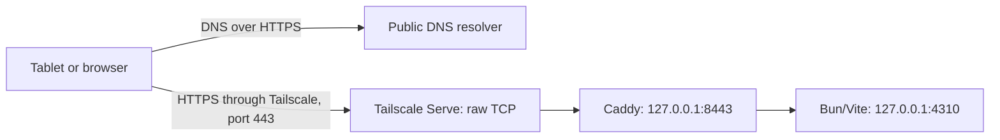

# Private HTTPS over Tailscale

Operational runbook for Hostinger DNS, a custom domain, Caddy, acme.sh, and Android Chrome Secure DNS. This remains a private, single-owner Vite development website, not a public internet deployment.

## Example deployment

Examples use `backlog.example.com`, the illustrative Tailscale address `100.64.0.10`, and `device.example-tailnet.ts.net`. Replace these with your own domain, server Tailscale IPv4 (`tailscale ip -4`), and MagicDNS hostname before running commands. These are not working service endpoints.

Open **https://backlog.example.com/** from a device connected to the tailnet. Use the explicit `https://` scheme. Application login is still required.



The public resolver supplies the address; it does not carry application traffic. Tailscale transports the connection, Caddy terminates HTTPS using the custom-domain certificate, and Bun enforces application authentication and request-origin checks.

**Remote access is tailnet-only**, subject to Tailscale ACLs/grants. Localhost access from the server also remains available. Publishing a DNS record does not make a Tailscale IP publicly reachable. Do not enable Tailscale Funnel, router port forwarding, or a public/LAN listener.

Public DNS exposes the hostname and its address. Certificate Transparency exposes the certificate hostname. Neither should contain information you intend to keep secret.

### What starts automatically

- `omp-backlog-proxy.service`: user service running Caddy.
- `omp-backlog-certificate.timer`: daily renewal check, randomized by up to one hour; missed checks are handled by its persistent timer.
- `omp-backlog-certificate.service`: one-shot acme.sh renewal check triggered by that timer.
- Tailscale Serve forwarding configured with `--bg` persists across Tailscale restarts and reboots.

**Bun is still run manually in its owning terminal.** Lingering keeps the user proxy/timer available after logout; it does not start Bun, keep a terminal-owned Bun process alive, or keep a powered-off machine online. After reboot, start Bun again before expecting the application to work.

## Why use a custom domain

Two distinct failures to distinguish:

1. **`DNS_PROBE_FINISHED_NXDOMAIN`:** a browser's custom Secure DNS provider can bypass Tailscale MagicDNS and cannot resolve a private `.ts.net` device record.
2. **`ERR_CONNECTION_REFUSED`:** using HTTP attempts port 80, where this setup has no listener. Use the full HTTPS URL.

Do not diagnose a connection refusal as a DNS failure without checking the complete URL. Chrome hides the scheme in its normal address-bar display; copy the full address when troubleshooting.

The custom domain has a public A record, so public Secure DNS resolvers can resolve it while the destination remains private to Tailscale. Browser Secure DNS can stay enabled. Provider-specific filtering can still affect results; verify the resolver actually in use rather than assuming all providers behave identically.

### DNS privacy is separate from HTTPS

Chrome Secure DNS protects DNS queries, not the HTTPS connection itself. Turning it off delegates resolution to the operating system and does not remove HTTPS encryption, but it also does not guarantee encrypted DNS. Android Private DNS set to **Automatic** does not guarantee encryption either.

The selected workaround is public DNS for the custom domain, not permanently disabling DNS privacy. An alternative for MagicDNS is to let Tailscale handle DNS and configure a supported public global nameserver in Tailscale; Tailscale automatically uses DNS-over-HTTPS for supported providers such as Cloudflare. That protection depends on Tailscale actually handling the queries.

Direct IP browsing is not a drop-in alternative: the installed certificate covers the domain, not `https://100.64.0.10`, and the application accepts only its configured remote origin. Do not bypass certificate warnings or weaken Host/Origin checks to make an IP URL work.

## DNS configuration in Hostinger

In hPanel, open the domain's **DNS/Nameserver → Kelola DNS record** section and add:

| Field | Value |
|---|---|
| Type / Tipe | `A` |
| Name / Nama | `backlog` |
| Value / Konten | Your server's Tailscale IPv4; example `100.64.0.10` |
| TTL | `300` seconds |

The name field is only `backlog`; hPanel appends your domain, such as `example.com`. The example result is `backlog.example.com`.

Leave existing `@`, `www`, nameservers, and unrelated records unchanged. Do not use **Reset DNS record**. A CNAME to a private MagicDNS name does not by itself give a public resolver the missing address record. Allow for DNS caching after changes.

## Files and prerequisites

Use the same Linux user for Bun, Caddy, acme.sh, and the user services. Run installation commands from the project root. The supplied files use an example domain, default Bun port, and certificate locations; adapt them deliberately for your deployment.

| Source or purpose | Installed location |
|---|---|
| [Caddyfile](../deploy/Caddyfile) | `~/.config/omp-backlog-web/Caddyfile` |
| [Proxy service](../deploy/omp-backlog-proxy.service) | `~/.config/systemd/user/omp-backlog-proxy.service` |
| [Renewal service](../deploy/omp-backlog-certificate.service) | `~/.config/systemd/user/omp-backlog-certificate.service` |
| [Renewal timer](../deploy/omp-backlog-certificate.timer) | `~/.config/systemd/user/omp-backlog-certificate.timer` |
| ACME account, DNS credentials, and internal certificate files | `~/.local/share/omp-backlog-acme/` |
| Stable certificate used by Caddy | `~/.local/share/omp-backlog-web/tls/fullchain.pem` |
| Stable private key used by Caddy | `~/.local/share/omp-backlog-web/tls/key.pem` |

These private data paths are outside the project source tree. Never put tokens, private keys, owner passwords, sessions, or account configuration in Git, tickets, attachments, screenshots, or chat. Backups containing these files are sensitive too.

Keep personal operational notes in `docs/private/` and local deployment overrides in `deploy/private/`; both are ignored by Git. Keep the generic runbook and templates public. Ignore rules prevent accidental additions, not deliberate `git add -f` or previously committed files. Store credentials outside this repository even when their filenames are ignored.

The canonical Caddy configuration disables automatic certificate management and HTTP redirects because acme.sh manages the certificate. It enables HTTP/1.1 and HTTP/2, not HTTP/3, because the forwarding path carries TCP. Strict SNI/Host matching rejects a conflicting HTTP Host before it reaches Bun.

### Install packages and configuration

On Arch Linux, install the packaged tools if needed; do not pipe a downloaded installer into a shell:

```sh
sudo pacman -S --needed caddy acme.sh
```

Review existing destination files before replacing them. Services use the installed copies, so changing files under `deploy/` alone does not update a running deployment.

```sh
mkdir -p "$HOME/.config/systemd/user"
install -d -m 700 "$HOME/.config/omp-backlog-web" \
  "$HOME/.local/share/omp-backlog-acme" \
  "$HOME/.local/share/omp-backlog-web/tls"
install -m 600 deploy/Caddyfile "$HOME/.config/omp-backlog-web/Caddyfile"
install -m 644 deploy/omp-backlog-proxy.service \
  deploy/omp-backlog-certificate.service \
  deploy/omp-backlog-certificate.timer "$HOME/.config/systemd/user/"
systemctl --user daemon-reload
```

Before continuing, edit the installed `~/.config/omp-backlog-web/Caddyfile` and replace `backlog.example.com` with your actual domain. Keep personal overrides out of the public template. Updating this repository's example does not alter an already installed configuration.

Do not start the system-wide Caddy service. This deployment uses a loopback-only user service and does not require Caddy or acme.sh to run as root.

## Obtain a Hostinger API token

In hPanel, go to **Dev → API → API tokens → New token**. Name the dedicated token, for example `omp-backlog-acme`, choose its expiration date, and generate it. Copy it immediately: Hostinger does not show it again after refresh.

The token must be able to manage this domain's DNS zone. Restrict permissions if the provider offers that option. Record its expiry securely: an expired or revoked token prevents renewal. The Hostinger DNS hook temporarily adds/removes the ACME verification TXT record; no public HTTP challenge port is needed.

Enter the token through a hidden terminal prompt, not as a literal command argument or assignment. Do not use `echo`, environment dumps, shell tracing (`set -x`), or ACME debug logging to inspect it. Do not add it to `.bashrc`, `.zshrc`, or a project `.env` file.

### Choose the prompt for your shell

**Bash**:

```bash
umask 077
read -r -s -p 'Hostinger API token: ' HOSTINGER_Token
printf '\n'
export HOSTINGER_Token
```

**zsh**:

```zsh
umask 077
read -r -s 'HOSTINGER_Token?Hostinger API token: '
printf '\n'
export HOSTINGER_Token
```

Use only the block matching your shell. Paste at the prompt and press Enter; invisible characters are expected. In zsh, Bash's `read -p` means “read from a coprocess” and produces `read: -p: no coprocess` instead of displaying the desired prompt.

## Issue and install the certificate

With the temporary variable exported in the same terminal:

```sh
acme.sh --issue \
  --home "$HOME/.local/share/omp-backlog-acme" \
  --server letsencrypt \
  --dns dns_hostinger \
  -d backlog.example.com \
  --keylength ec-256
```

Then remove the variable from the terminal, including if issuance failed:

```sh
unset HOSTINGER_Token
```

The provider hook saves the credential in the private ACME home for later renewal; unsetting the terminal variable does not remove that saved credential. Proceed only after issuance succeeds. Do not assume that merely exporting a replacement token updates an already saved renewal credential.

Check the public certificate metadata without reading a private key or account file:

```sh
openssl x509 \
  -in "$HOME/.local/share/omp-backlog-acme/backlog.example.com_ecc/fullchain.cer" \
  -noout -subject -issuer -dates -ext subjectAltName
```

Install the certificate to stable paths and save the reload hook:

```sh
umask 077
acme.sh --install-cert \
  --home "$HOME/.local/share/omp-backlog-acme" \
  -d backlog.example.com --ecc \
  --key-file "$HOME/.local/share/omp-backlog-web/tls/key.pem" \
  --fullchain-file "$HOME/.local/share/omp-backlog-web/tls/fullchain.pem" \
  --reloadcmd 'systemctl --user reload-or-restart omp-backlog-proxy.service'
caddy validate --config "$HOME/.config/omp-backlog-web/Caddyfile" --adapter caddyfile
systemctl --user enable --now omp-backlog-proxy.service omp-backlog-certificate.timer
```

The reload hook can start the private proxy on the initial installation. On renewal, it reloads Caddy. The proxy unit uses `caddy reload --force`: certificate filenames stay the same, so the contents must be reloaded even when the configuration itself has not changed. Do not point Caddy directly at acme.sh's internal certificate files.

Keep the ACME directory mode `700` and the saved account configuration/private key mode `600`. Inspect permissions, not contents:

```sh
stat -c '%a %n' \
  "$HOME/.local/share/omp-backlog-acme" \
  "$HOME/.local/share/omp-backlog-acme/account.conf" \
  "$HOME/.local/share/omp-backlog-web/tls/key.pem"
```

## Activate the custom domain

### Restart the existing Bun process

Wait for active application runs to finish. In the terminal that owns the existing Bun process, stop it gracefully with Ctrl+C. Do not start a second instance or kill an unidentified process.

From the project root:

```sh
OMP_BACKLOG_ORIGIN=https://backlog.example.com bun run dev
```

Set this variable on every manual start. It selects one exact HTTPS remote origin; other remote hosts stay blocked. Custom URL ports, credentials, paths, queries, and fragments are rejected. The browser uses the default HTTPS port; Caddy's internal port is not part of the browser URL. Localhost HTTP remains available. Proxy-forwarded headers do not grant access or bypass authentication, same-origin checks, or CSRF protection.

### Verify locally before changing forwarding

This retains the real hostname for SNI, Host, and certificate verification while connecting directly to loopback Caddy:

```sh
curl --noproxy '*' --fail-with-body \
  --connect-to backlog.example.com:443:127.0.0.1:8443 \
  https://backlog.example.com/api/health
```

Expect HTTP 200 with JSON containing `"status":"ok"`. Do not use `-k` or `--insecure`. If it returns 403, check that Bun was restarted with the new origin before proceeding.

### Switch Tailscale port 443

Inspect the current configuration first:

```sh
tailscale serve status
```

For migration from the previous `.ts.net` HTTPS proxy, remove that port-443 handler and replace it with raw TCP forwarding:

```sh
sudo tailscale serve --bg --https=443 off &&
sudo tailscale serve --bg --tcp=443 tcp://127.0.0.1:8443
```

On a fresh deployment with no HTTPS handler on 443, run only the TCP-forwarding command. A configured Tailscale operator may not need `sudo`.

Use `--tcp`, not `--tls-terminated-tcp`: **Caddy must receive the original TLS connection** and present the custom-domain certificate. This is a clean cutover, with a brief interruption while restarting/switching. The old `.ts.net` HTTPS URL is retired; its hostname may still appear in Serve's raw TCP status, but it is not the custom certificate's browser URL. Do not use `tailscale serve reset`, which would remove unrelated entries.

Enable user lingering so proxy and renewal scheduling can continue after logout:

```sh
sudo loginctl enable-linger "$USER"
```

### Verify the final URL and tablet

```sh
curl --noproxy '*' --fail-with-body \
  https://backlog.example.com/api/health
```

On the Android tablet:

1. Connect Tailscale to the same tailnet, with access permitted by ACLs/grants.
2. Leave Chrome Secure DNS enabled if desired.
3. Open your custom-domain HTTPS URL (example: **https://backlog.example.com/**) and sign in normally.
4. Do not use HTTP, an IP URL, the old `.ts.net` bookmark, or ports 4310/8443 in the address bar.

## Routine operation and renewal

Check services and the next scheduled renewal check:

```sh
systemctl --user is-active omp-backlog-proxy.service omp-backlog-certificate.timer
systemctl --user list-timers omp-backlog-certificate.timer --no-pager
loginctl show-user "$USER" -p Linger
```

Run a normal renewal check manually when diagnosing scheduling. It renews only when due; it does not force a new certificate:

```sh
systemctl --user start omp-backlog-certificate.service
systemctl --user show omp-backlog-certificate.service -p Result -p ExecMainStatus
```

A successful check can simply mean the existing certificate is not due. It is not proof that a fresh certificate was issued or that an expired API token would work later. Keep the machine online, preserve the private ACME home, and replace saved credentials before token expiry according to the provider/client instructions.

Inspect failures locally and redact credentials before sharing logs:

```sh
journalctl --user -u omp-backlog-proxy.service --since today
journalctl --user -u omp-backlog-certificate.service --since today
```

After intentionally updating the installed Caddy configuration:

```sh
caddy validate --config "$HOME/.config/omp-backlog-web/Caddyfile" --adapter caddyfile &&
systemctl --user reload omp-backlog-proxy.service
```

After changing installed unit files, run `systemctl --user daemon-reload`. To restart Bun, return to its owning terminal and use the custom-origin command again. Stopping Bun makes the application unavailable even if the proxy and certificate remain healthy.

## Troubleshooting

| Symptom | Check and response |
|---|---|
| `DNS_PROBE_FINISHED_NXDOMAIN` | Check the exact hostname and public A record. A custom Secure DNS provider can bypass MagicDNS; use the custom domain rather than the private `.ts.net` name. Check the actual resolver's answer and any filtering policy. |
| `ERR_CONNECTION_REFUSED` | Copy the full URL and inspect its scheme/port first. HTTP uses closed port 80; this setup intentionally has no redirect there. For explicit HTTPS, inspect Serve status, tailnet access, and listeners rather than changing DNS blindly. |
| `Port 4310 is already in use` | An existing Bun process is likely running. Identify it with the listener command below; stop it gracefully in its owning terminal before restarting. Do not create a second instance. |
| HTTP 403 after changing domains | Bun may still be running with the old `OMP_BACKLOG_ORIGIN`, or the request has an unapproved Origin/Host. Restart with the exact custom origin; do not disable these checks. |
| HTTP 421 for mismatched Host | Caddy's strict TLS SNI/HTTP Host check rejected the request. Use the actual certificate hostname. |
| HTTP 401 from `/api/state` | Expected without an authenticated session. Health/session endpoints working does not mean protected data should be public. |
| Proxy HTTP 502 | Check that Bun is running on its configured loopback port. Do not expose Bun to the LAN as a workaround. |
| Certificate warning or TLS error | Check hostname, expiry, system clock, and Caddy's loaded certificate. An IP URL does not match this domain certificate. Never bypass validation. |
| `read: -p: no coprocess` | Bash prompt syntax was run in zsh. Use the shell-specific prompt above; do not put the token into a literal command to work around it. |
| Renewal fails | Inspect the renewal service locally; check token expiry/permissions, DNS-provider errors, network availability, and the preserved ACME home. Do not delete application data or private keys to clear the error. |
| Proxy works after login but not after reboot/logout | Check lingering and enabled user services. Bun is manual and must also be started; a healthy proxy alone is insufficient. |

Read-only listener and forwarding diagnostics:

```sh
ss -ltnp '( sport = :80 or sport = :443 or sport = :4310 or sport = :8443 )'
tailscale serve status
systemctl --user status omp-backlog-proxy.service
```

Bun/Caddy should be loopback-only; the external HTTPS listener belongs to the Tailscale addresses, not `0.0.0.0` or a public/LAN address. This setup has no listener on port 80.

To distinguish public DNS-over-HTTPS from local resolver behavior, query a known public resolver without changing system/browser settings:

```sh
curl --noproxy '*' --fail \
  -H 'accept: application/dns-json' \
  'https://cloudflare-dns.com/dns-query?name=backlog.example.com&type=A'
```

Expect DNS `Status: 0` and the configured A-record address. This tests Cloudflare specifically, not every Secure DNS provider or the tablet's current resolver.

## Disable sharing or roll back

To stop remote access while preserving local Bun access and other Serve entries:

```sh
sudo tailscale serve --bg --tcp=443 off
```

The renewal timer can remain enabled during a temporary outage. If deliberately retiring this deployment, disable its user proxy/timer as well, and revoke the dedicated DNS token in Hostinger when it is no longer needed. Do not disable user lingering blindly: other user services may depend on it. Do not delete application data, keys, or account configuration as a troubleshooting shortcut.

To return to MagicDNS-based HTTPS instead of the custom domain:

1. Wait for active work to finish and stop Bun gracefully in its terminal.
2. Restart with your device's exact MagicDNS origin, replacing the example hostname:

   ```sh
   OMP_BACKLOG_ORIGIN=https://device.example-tailnet.ts.net bun run dev
   ```

3. In another terminal, switch only the port-443 handler:

   ```sh
   sudo tailscale serve --bg --tcp=443 off &&
   sudo tailscale serve --bg --https=443 http://127.0.0.1:4310
   ```

4. Use the HTTPS URL printed by Serve. That `.ts.net` name again requires MagicDNS-compatible client DNS; it does not solve a custom Secure DNS provider bypassing MagicDNS.

## Deployment verification checklist

Run these checks against your own deployment; the example endpoints above are not live verification targets:

- Custom-domain health returns HTTP 200 with normal certificate verification through the tailnet TCP-forwarding path.
- The sign-in page renders without DNS overrides or certificate bypasses; unauthenticated protected state returns 401.
- Your Secure DNS provider resolves the public A record to your server's Tailscale IP.
- HTTPS session cookies have `Secure` and `HttpOnly`; an unapproved Origin returns 403 and a mismatched TLS/HTTP Host returns 421.
- Bun/Caddy listeners are loopback-only; port 443 listens on Tailscale addresses, with no port-80 listener.
- Proxy and renewal timer are active, `Linger=yes`, and a normal renewal check completes successfully. A successful check does not prove fresh issuance.
- Inspect the installed certificate's current hostname and expiry rather than relying on a date copied into documentation.
- Verify the actual tablet with its intended Secure DNS provider; a server-side check cannot prove device-specific behavior.

## References

- [Hostinger API token creation](https://www.hostinger.com/support/10840865-what-is-hostinger-api/)
- [Packaged ACME client's Hostinger DNS hook](https://github.com/acmesh-official/acme.sh/blob/master/dnsapi/dns_hostinger.sh)
- [acme.sh certificate installation and renewal](https://github.com/acmesh-official/acme.sh#readme)
- [Tailscale DNS and supported encrypted global resolvers](https://tailscale.com/docs/reference/dns-in-tailscale)
- [Tailscale Serve TCP forwarding](https://tailscale.com/docs/reference/tailscale-cli/serve#use-a-tcp-forwarder)
- [Tailscale HTTPS certificates and hostname disclosure](https://tailscale.com/docs/how-to/set-up-https-certificates)
